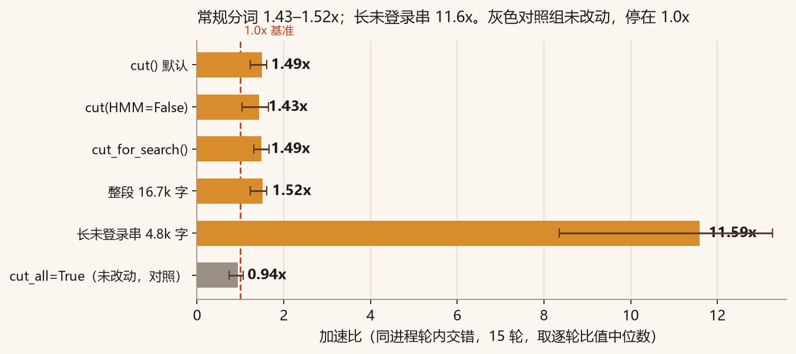
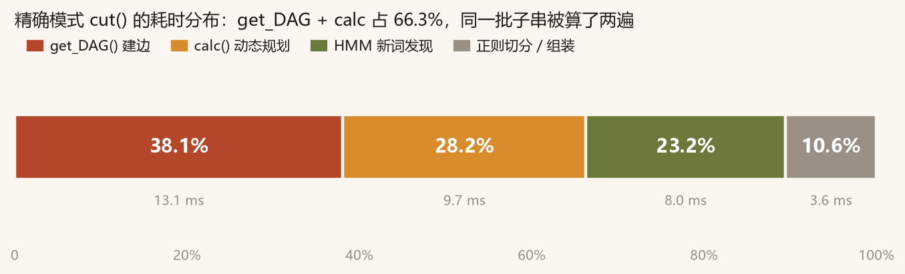
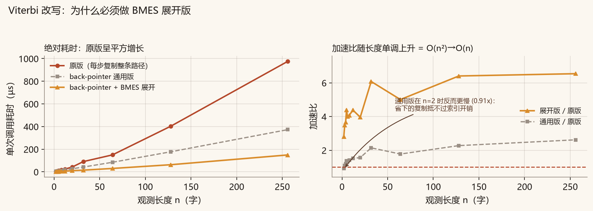
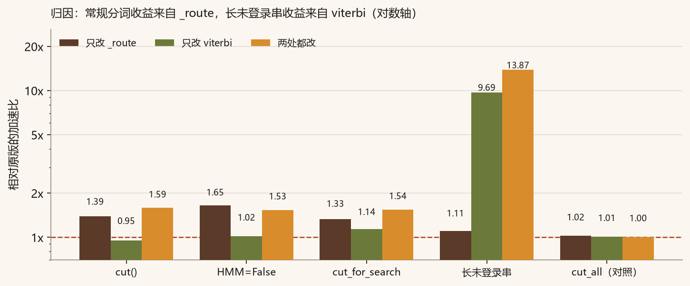

# jieba 精确模式分词热路径优化

对 [fxsjy/jieba](https://github.com/fxsjy/jieba)（35,197 stars，MIT）的两处算法级优化：
把"建 DAG + 逆向 DP"两遍扫描合成一遍，把 HMM Viterbi 的 O(n²) 路径复制改成
back-pointer。**输出逐字节不变**，常规分词 **1.49x**，长未登录串 **11.59x**。



> 上游：https://github.com/fxsjy/jieba
> 基线：`0.42.1` / `master` @ `67fa2e36`
> 许可证：MIT，版权归 Sun Junyi（`LICENSE` 原样保留，未改动）

---

## 目录结构

```
jieba-opt-lab/
├── optimized/                 # 优化版完整源码（含上游全部词典/模型/测试）
├── docs/                      # README 引用的四张性能图
├── jieba-optimization.patch   # 相对上游的 unified diff
├── original.sha256            # 被修改的两个文件的原始 SHA256（可核对基线）
├── PATCH.md                   # 缺陷分析 / 方案 / 实测数据 / 踩坑记录
├── README.md                  # 本文件
├── corpus.json                # 固定语料（按真实词频采样，可复现）
├── make_corpus.py             # 语料生成脚本
├── verify_equivalence.py      # 全模式逐字节比对
├── fuzz_equivalence.py        # 模糊测试（4,291 例）
├── verify_viterbi.py          # viterbi 专项穷举（6,655 例）
├── test_optimization.py       # 16 项回归测试
├── bench_stages.py            # cut() 内部阶段耗时拆分
├── bench_final.py             # 端到端基准（主结论来源）
├── bench_final.json           #   第 1 轮原始数据
├── bench_final_rerun.json     #   解压 ZIP 后第 2 轮复测原始数据
├── bench_viterbi_impls.py     # viterbi 三实现 × 长度对比
├── bench_ablation.py          # 四臂归因（跨进程，读趋势）
├── make_figures.py            # 由上面这些 JSON 生成 docs/ 里的图
└── bench_*.json               # 上述基准的原始数据
```

### 没有重复打包原版源码

`original/` 不单独附带，因为它是 55 MB（主要是词典和模型），而它可由补丁**逐字节**
重建。已验证：

```bash
cp -r optimized /tmp/recon && cd /tmp/recon
git -c core.autocrlf=false apply -R -p1 --whitespace=nowarn ../jieba-optimization.patch
# 重建结果与被修改文件的原始 SHA256 完全一致
```

`original.sha256` 里记的是**上游原始文件**的哈希，我已用 codeload 重新下载
`fxsjy/jieba@master` 交叉核对过，两者一致。想自己验：

```bash
curl -sL https://codeload.github.com/fxsjy/jieba/tar.gz/refs/heads/master | tar xz
sha256sum jieba-master/jieba/__init__.py jieba-master/jieba/finalseg/__init__.py
cat original.sha256   # 应当一致
```

## 快速验证

```bash
# 依赖：numpy（jieba 需要）、pytest、matplotlib（仅重绘图表时需要）
pip install numpy pytest matplotlib

cd jieba-opt-lab

# 1. 正确性
python verify_equivalence.py     # 全模式逐字节比对 -> ALL IDENTICAL
python verify_viterbi.py         # viterbi 穷举      -> ALL IDENTICAL
python fuzz_equivalence.py       # 模糊测试          -> ALL IDENTICAL
python -m pytest test_optimization.py -q   # 16 passed

# 2. 上游自带测试（11 个脚本全过）
cd optimized/test
for f in test.py test_no_hmm.py test_cutall.py test_cut_for_search.py \
         test_tokenize.py test_pos.py test_bug.py test_userdict.py \
         test_change_dictpath.py test_pos_no_hmm.py test_tokenize_no_hmm.py; do
  python "$f" || echo "FAIL $f"
done
cd ../..

# 3. 性能
python bench_stages.py           # cut() 内部阶段拆分
python bench_final.py            # 端到端（主结论）
python bench_viterbi_impls.py    # viterbi 按长度
python make_figures.py           # 由上面的 JSON 重新出图（需要 matplotlib）
```

## 实测结果



精确模式 `cut()` 的耗时里，`get_DAG()` 38.1% + `calc()` 28.2% = **66.3%** 都花在
同一批子串上（先判"是不是词"，再查"频次多少"）。这就是优化的着力点。

同进程轮内交错、15 轮、逐轮比值取中位数。语料：从 jieba `dict.txt` 按真实词频
采样组成 400 句 / 16,735 字。

| 模式 | 原版 | 优化版 | 加速比 |
|---|---:|---:|---:|
| `cut()` 默认 | 37.54 ms | 26.71 ms | **1.49x** |
| `cut(HMM=False)` | 27.71 ms | 19.70 ms | **1.43x** |
| `cut_for_search()` | 39.74 ms | 26.67 ms | **1.49x** |
| `cut(cut_all=True)`（未改动，对照组） | 21.68 ms | 22.66 ms | 0.94x |
| 长未登录串 4,800 字 | 831.23 ms | 71.47 ms | **11.59x** |

解压 ZIP 到干净目录后独立复测：`cut` 1.54x、`nohmm` 1.45x、`search` 1.54x、
对照组 1.01x、长串 11.80x —— 与上表一致。完整两轮数据见 PATCH.md §4.1 / §4.1b。

### Viterbi 为什么必须做展开版



左图是绝对耗时：原版随 n 平方增长（n=256 时单次 975 µs），展开版只有 149 µs。
右图是加速比：**通用 back-pointer 版在 n=2 时是 0.91x，反而更慢**——省下的复制量
抵不过多出来的索引运算。而真实中文语料 61% 的 HMM 调用就是 2 字，所以必须做
BMES 完全展开的快路径，否则常规分词会退步。

### 归因：两处改动各管一段



A 原版 / B 只改 `_route` / C 只改 `viterbi` / D 两者。常规分词的提速几乎全来自
`_route`（HMM 只占 23% 且输入极短），长未登录串的收益全来自 `viterbi`。
`cut_all` 这一列三根柱子都贴着 1.0x——它根本没走改动的代码，是测量可信的旁证。

完整数据、归因表、以及两个"差点翻车"的细节（浮点结合律、平局规则）见 **PATCH.md**。

## 改了什么

| 文件 | 改动 |
|---|---|
| `jieba/__init__.py` | 新增 `Tokenizer._route()`：单遍逆序融合建边+DP；`__cut_DAG` / `__cut_DAG_NO_HMM` 改用它 |
| `jieba/finalseg/__init__.py` | `viterbi()` 改 back-pointer + BMES 完全展开快路径；保留 `_viterbi_generic` 兼容任意状态集 |

`get_DAG()` / `calc()` 原样保留（公开 API），`LICENSE` 未改动，
所有改动处均有 `(optimization, see PATCH.md)` 标注。

## 应用方式

```bash
# 方式一：直接使用 optimized/
cd optimized && python -c "import jieba; print(jieba.lcut('我来到北京清华大学'))"

# 方式二：打补丁到干净的上游
cd /path/to/jieba
git apply /path/to/jieba-optimization.patch
```

## 已知限制

- `posseg`（词性标注）未优化：它走另一套 `__cut_detail` HMM，实测 1.02x。
- 直接调用 `get_DAG` / `calc` 的外部代码不会变快（为兼容性保留原实现）。
- 基准是本机单次测量（Windows / CPython 3.13.14），**比值可迁移，绝对值不可迁移**。
